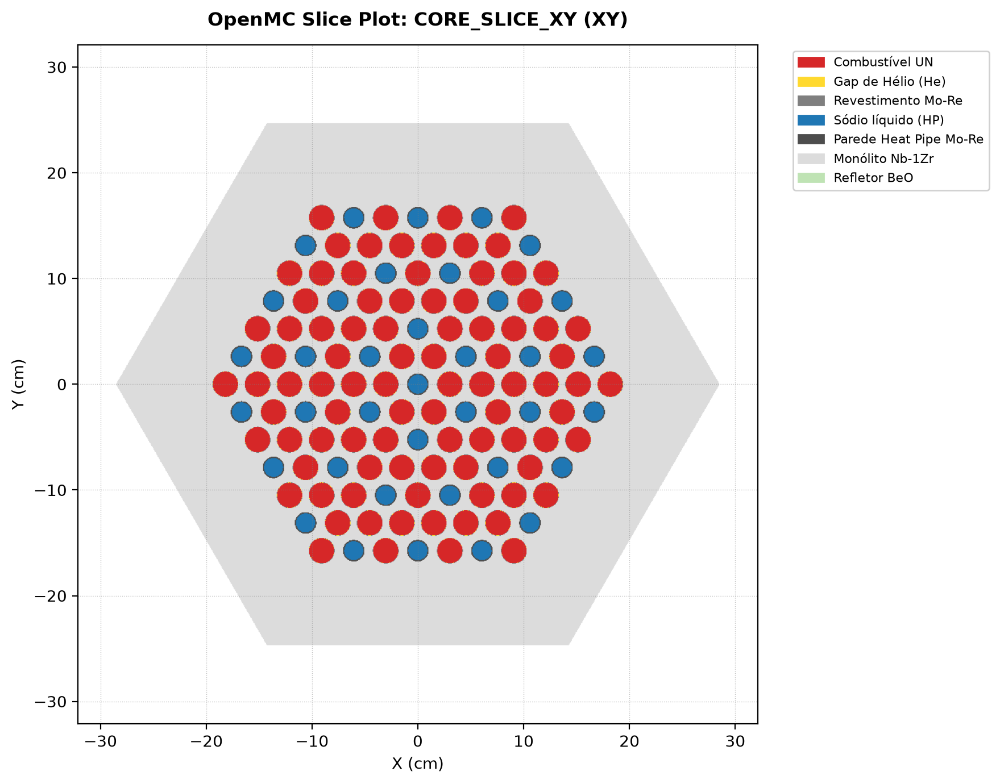
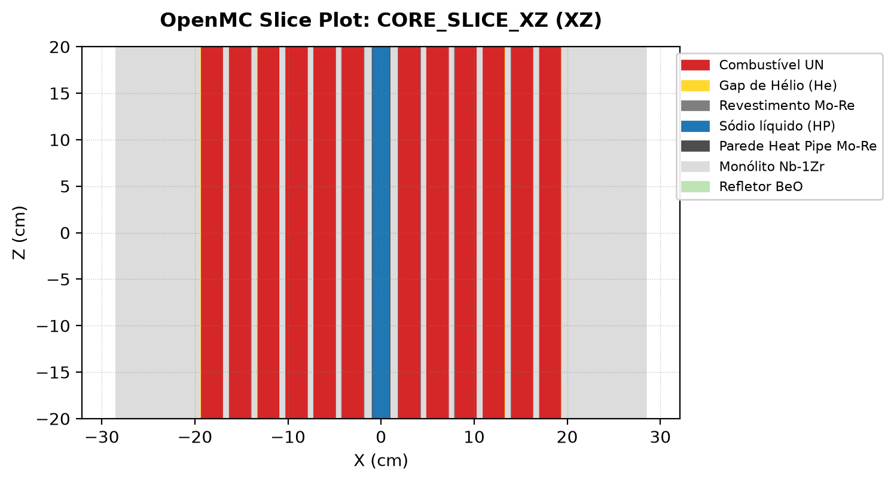
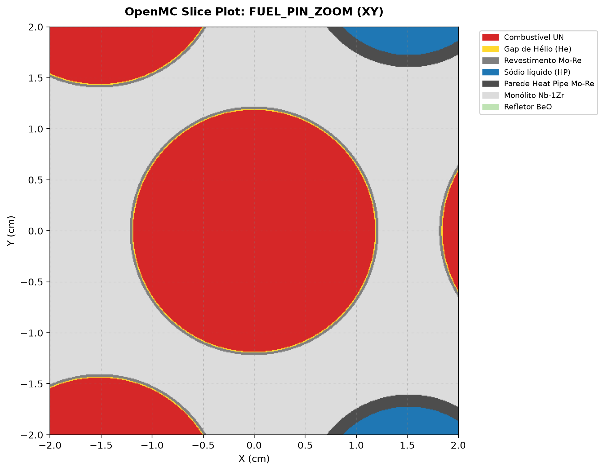
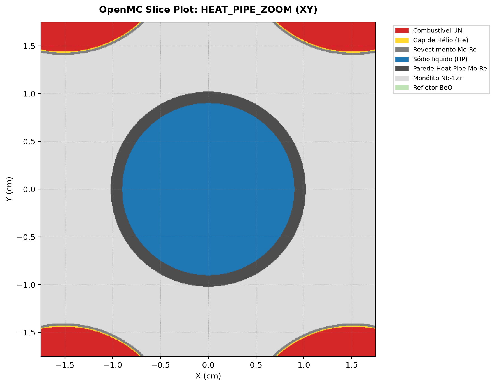
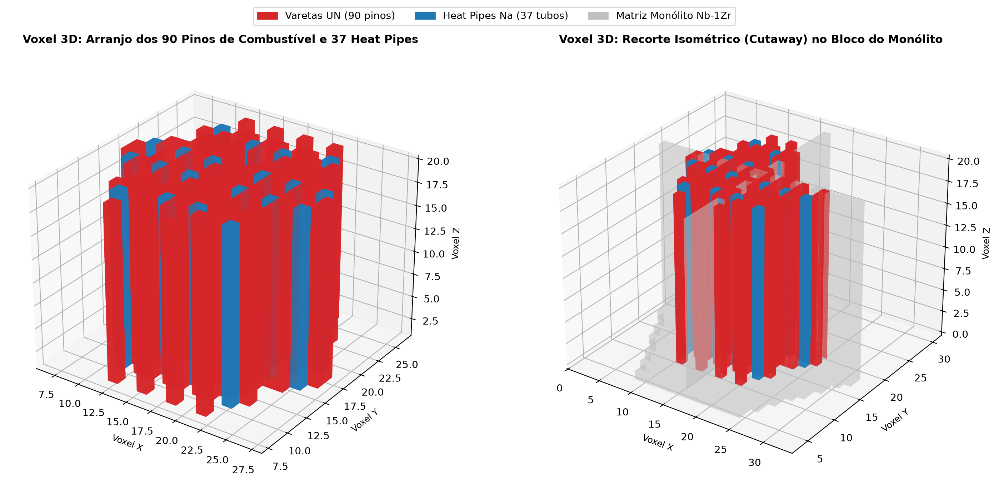
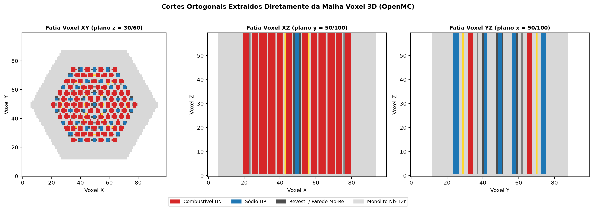

# Geometry visualization

The microreactor package can generate OpenMC material-colored cross-sections
and 3D voxel views without running a transport calculation. OpenMC cross-section
data are not required for this geometry-only workflow.

From the repository root, run:

```bash
heat-pipe-geometry-plots \
  --config reactors/heat-pipe-microreactor/config/reference.yaml \
  --output-dir reactors/heat-pipe-microreactor/simulation-output/geometry
```

The command creates five 2D slices (XY, XZ, YZ, a fuel-pin zoom, and a heat-pipe
zoom), a 3D voxel rendering, and orthogonal slices of the voxel grid. Slice
dimensions, material colors, enrichment by ring, and optional reflector
configuration are taken from the selected YAML file. OpenMC XML files and the
voxel HDF5 file are created in a temporary working directory and removed when
generation completes; only PNG images are retained in the output directory.

## Latest included figures

The following lightweight figures were copied from the latest geometry run
available in the source workspace. The source run included four 2D views and
two voxel views; it did not include a YZ slice.

### Core and component slices









### Voxel views





The original HDF5 and VTK voxel data are not included. Regenerate them if
needed for external visualization, or adapt the generator to retain those
files for a specific workflow.
